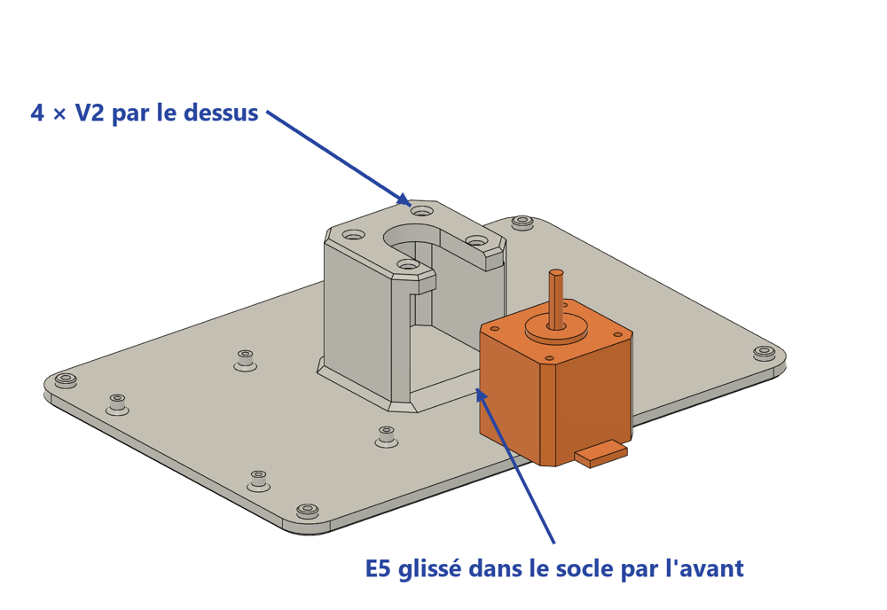

# redaction-documentation

A Claude Code skill that writes or reworks the assembly manual of a home-made hardware project: electronics, a board to solder, 3D-printed parts, wiring, firmware. The manual is written in Markdown and assembled into a PDF, with one illustration per step.

First version. It will be updated as it gets used, and its content may still change. The skill comes in English (the default) and in French (the original, in `fr/`). The English version is a translation: the author uses the French one, and the English one has not been run yet. Its name is French for "writing documentation".

## Requirements

- Claude Code.
- The files of the project to document: 3D models, Gerber files, netlist, datasheets, firmware, photos.
- The skill plans to measure dimensions and generate 3D views in Fusion 360, so Claude needs access to it for that part.

## Installation

```bash
git clone https://github.com/StashWorkshop/redaction-documentation-skill.git
cp -r redaction-documentation-skill/redaction-documentation ~/.claude/skills/
```

For the French version, copy `redaction-documentation-skill/fr/redaction-documentation` instead. Install only one of the two: they share the same skill name.

## Usage

Ask, for example: "Write the assembly manual for this project." The English version writes the manual in your language.

The skill starts with an inventory of everything the manual will mention. When something is missing (a component's 3D model, a datasheet, a photo, the firmware), it offers to download it and names a likely source, rather than inventing it or doing without. It checks facts in the files and asks the user for what only they know.

The manual follows the order of the build, in numbered chapters: overview, bill of materials with checkboxes, circuit board, 3D printing, assembly, wiring, firmware and first test, closing the case, troubleshooting. Each operation has its own step and image, each part keeps the same reference in the bill of materials, the images and the text, and each chapter ends with a check.



*Illustration of one step, taken from a manual written with this skill for a resin parts washer. The part fitted at this step is in colour, and E5 and V2 are its references in the bill of materials.*

## Known limits

- The skill is a single `SKILL.md` file with no scripts. The scripts it mentions (3D views, labels, SVG diagrams, PDF assembly) have to be written in each project.
- It is designed for projects that combine electronics and printed parts. Chapters that do not apply to another kind of project should be removed.

## License

MIT. See the `LICENSE` file.
